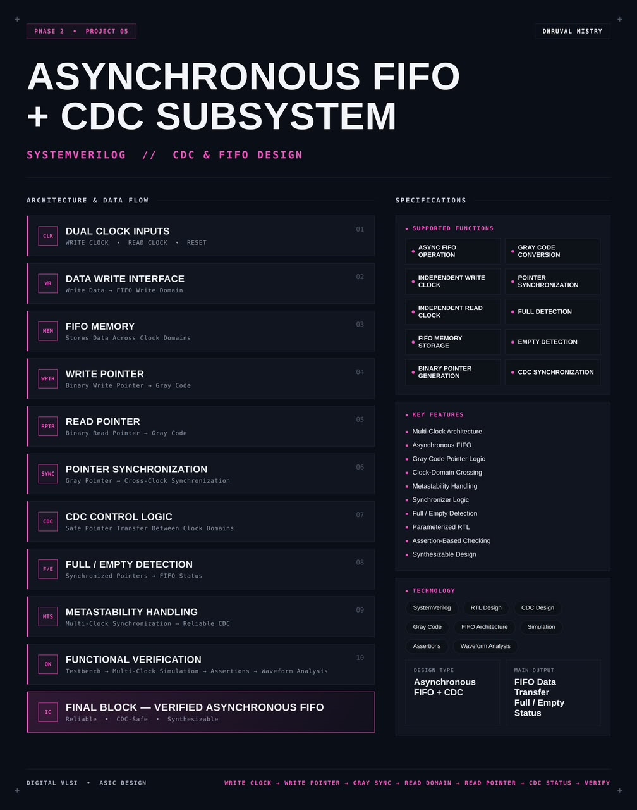
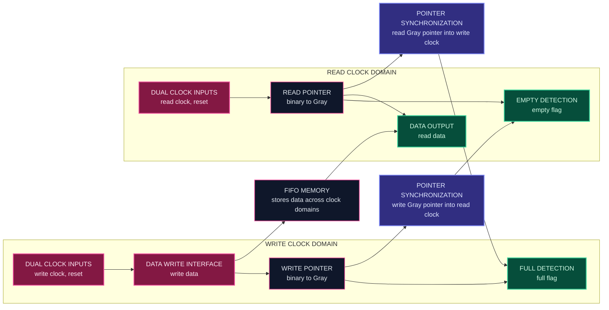
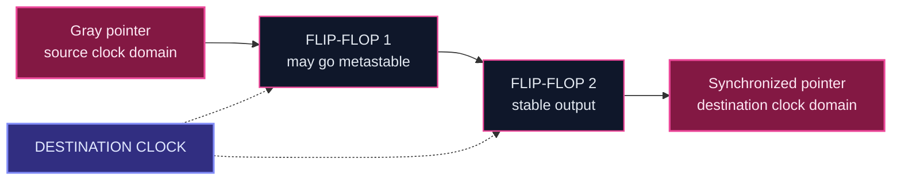
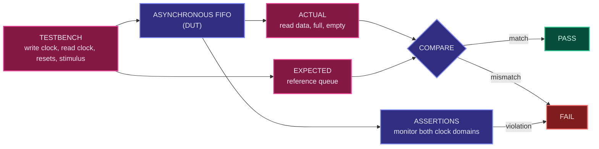

<div align="center">




<b>A synthesizable dual-clock asynchronous FIFO with Gray code pointers, two-stage pointer synchronizers and full and empty detection for safe clock domain crossing, written in SystemVerilog.</b>

<br/>


<br/>

[Overview](#overview) |
[At a Glance](#project-at-a-glance) |
[Background](#background-clock-domain-crossing) |
[Functions](#supported-functions) |
[Architecture](#architecture) |
[Functional Description](#functional-description) |
[Pointer and CDC Logic](#pointer-and-cdc-logic) |
[Interface](#interface) |
[Operating Sequence](#operating-sequence) |
[Getting Started](#getting-started) |
[Verification](#verification) |
[Synthesis](#synthesis) |
[Applications](#applications) |
[FAQ](#faq) |
[License](#license)

</div>

---

## Overview

This project implements an **asynchronous FIFO with a clock domain crossing (CDC) subsystem** in **SystemVerilog**.

An asynchronous FIFO moves data between two parts of a chip that run on **unrelated clocks**. The **write side** has its own write clock and the **read side** has its own read clock. Data is stored in a shared **FIFO memory**. Each side keeps a binary **pointer** for addressing the memory and converts it to **Gray code** before it is sent to the other side. A **pointer synchronizer** brings each Gray pointer safely into the opposite clock domain, and **full and empty detection** logic uses the synchronized pointers to decide when to stop writing or reading. **CDC control logic** makes sure that only safe, synchronized information crosses between the two clock domains, and **metastability handling** protects the receiving flip-flops from unstable values.

The design is **parameterized**, **sequential** and written in a **synthesis-friendly** style. It is checked with a **multi-clock testbench**, **assertions** and waveform analysis, and packaged as a reusable asynchronous FIFO IP block.

<table>
<tr>
<td width="50%" valign="top">

#### Objectives
- Design a reusable asynchronous FIFO in SystemVerilog
- Allow the write and read sides to use independent clocks
- Generate binary pointers and convert them to Gray code
- Synchronize the pointers across the clock domains safely
- Detect full in the write domain and empty in the read domain
- Handle metastability with multi-stage synchronization
- Verify the design under many clock ratios and phase offsets

</td>
<td width="50%" valign="top">

#### Key Features
- Multi-clock architecture
- Asynchronous FIFO
- Gray code pointer logic
- Clock-domain crossing
- Metastability handling
- Synchronizer logic
- Full and empty detection
- Parameterized RTL
- Assertion-based checking
- Synthesizable design

</td>
</tr>
</table>

---

## Project at a Glance

| Attribute | Detail |
|:--|:--|
| **Design type** | Asynchronous FIFO with CDC subsystem |
| **Description language** | SystemVerilog (RTL) |
| **Logic style** | Sequential, two independent clock domains |
| **Clocks** | Write clock and read clock, with no required relationship |
| **Storage** | FIFO memory shared by both domains |
| **Pointer crossing** | Gray code pointers through synchronizers |
| **Synchronizer** | Multi-stage flip-flop synchronizer |
| **Status flags** | Full (write domain), empty (read domain) |
| **Configurability** | Parameterized data width and FIFO depth |
| **Main output** | FIFO data transfer, full and empty status |
| **Checking** | Multi-clock testbench, assertions, waveform analysis |
| **Functions** | 12 (async FIFO, clocks, storage, pointers, Gray code, synchronization, detection, CDC) |
| **Simulation** | Verilator |
| **Waveform analysis** | GTKWave |
| **Synthesis** | Yosys |
| **License** | MIT |

---

## Background: Clock Domain Crossing

Modern chips contain many blocks that run at different clock frequencies. A sensor interface may run slowly, a processor core quickly, and a communication port at a rate set by an external standard. When data has to pass between two such blocks, the signals cross from one **clock domain** into another. This is called **clock domain crossing**, or **CDC**.

Crossing is dangerous because a flip-flop needs its input to be stable for a short time around the clock edge, called setup and hold time. If a signal from another domain changes right at that moment, the flip-flop can enter a **metastable** state, where its output hovers between 0 and 1 for an unpredictable time before it settles to one of them. A metastable value that spreads into the rest of the logic can cause wrong behavior that is very hard to reproduce.

There are two classic problems to solve:

1. **Metastability.** The receiving flip-flop must be given enough time to settle. A **two-stage (or longer) flip-flop synchronizer** does this: the first flip-flop may go metastable, but it has a full clock period to resolve before the second flip-flop samples it.
2. **Multi-bit coherence.** If a multi-bit value such as a pointer is passed through synchronizers, each bit can be captured on a different clock edge. If several bits change at once, the receiver can briefly see a value that never existed, for example `0111` changing to `1000` may be seen as `1111`. A **Gray code** fixes this, because only one bit changes between two consecutive values. A receiver therefore sees either the old value or the new value and never a corrupt one.

The asynchronous FIFO combines both ideas. Only Gray coded pointers cross between the domains, and each one passes through a synchronizer. The data itself never crosses through a synchronizer. It stays in the memory and is read by the read side only after the synchronized pointers show that it is valid.

---

## Supported Functions

| Group | Function | Description |
|:--|:--|:--|
| **Operation** | `ASYNC FIFO OPERATION` | Transfers data between two unrelated clock domains |
| **Clocking** | `INDEPENDENT WRITE CLOCK` | Write side runs on its own clock |
| **Clocking** | `INDEPENDENT READ CLOCK` | Read side runs on its own clock |
| **Storage** | `FIFO MEMORY STORAGE` | Memory that holds the data in transit |
| **Pointers** | `BINARY POINTER GENERATION` | Binary write and read pointers that address the memory |
| **Pointers** | `GRAY CODE CONVERSION` | Converts binary pointers to Gray code for safe crossing |
| **CDC** | `POINTER SYNCHRONIZATION` | Brings each Gray pointer into the opposite clock domain |
| **CDC** | `CDC SYNCHRONIZATION` | Multi-stage synchronization with metastability protection |
| **Status** | `FULL DETECTION` | Tells the write side when no space is left |
| **Status** | `EMPTY DETECTION` | Tells the read side when no data is left |

---

## Architecture

The design has two clock domains. The **write domain** holds the data write interface, the write pointer and the full detection. The **read domain** holds the read pointer, the empty detection and the data output. Between them sit the FIFO memory and two pointer synchronizers, which are the only paths that cross the clock domain boundary.

#### Block diagram

```text
        WRITE CLOCK DOMAIN (wclk)                          READ CLOCK DOMAIN (rclk)
 +--------------------------------------+            +--------------------------------------+
 |                                      |            |                                      |
 |  WRITE DATA --------+                |            |                 +------------------> READ DATA
 |                     v                |            |                 |                    |
 |               +-----------+          |  write     |           +-----+-----+              |
 |  WRITE        |   WRITE   |--------------------------------->|   FIFO    |              |
 |  ENABLE ----->|   LOGIC   |          |  data      |  read     |  MEMORY   |              |
 |               +-----+-----+          |            |  data     +-----+-----+              |
 |                     |                |            |                 ^                    |
 |               +-----v-----+          |            |           +-----+-----+              |
 |               |  WRITE    |   binary |            |   binary  |   READ    |<---- READ    |
 |               |  POINTER  |--> addr  |            |   addr <--|  POINTER  |      ENABLE  |
 |               +-----+-----+          |            |           +-----+-----+              |
 |                     | binary to Gray |            |      binary to Gray |                |
 |               +-----v-----+          |            |           +-----v-----+              |
 |               | WPTR GRAY |          |            |           | RPTR GRAY |              |
 |               +-----+-----+          |            |           +-----+-----+              |
 |                     |                |            |                 |                    |
 |                     |   +------------+------------+--------------+  |                    |
 |                     +-->|   SYNC wptr into rclk  (2-stage FF)   |---> to EMPTY DETECTION |
 |                         +------------+------------+--------------+                       |
 |                         +------------+------------+--------------+                       |
 |  FULL DETECTION <-------|   SYNC rptr into wclk  (2-stage FF)   |<--+                    |
 |        |                +------------+------------+--------------+                       |
 |        v                             |            |                       |              |
 |      FULL                            |            |                     EMPTY            |
 +--------------------------------------+            +--------------------------------------+
        CDC boundary: only synchronized Gray code pointers cross
```

#### Data flow



#### Block breakdown

| # | Block | Role |
|:-:|:--|:--|
| `01` | **Dual Clock Inputs** | Write clock, read clock and reset |
| `02` | **Data Write Interface** | Write data entering the FIFO write domain |
| `03` | **FIFO Memory** | Stores data across the clock domains |
| `04` | **Write Pointer** | Binary write pointer, converted to Gray code |
| `05` | **Read Pointer** | Binary read pointer, converted to Gray code |
| `06` | **Pointer Synchronization** | Brings each Gray pointer into the opposite clock domain |
| `07` | **CDC Control Logic** | Makes sure pointers cross the domains safely |
| `08` | **Full and Empty Detection** | Turns the synchronized pointers into FIFO status |
| `09` | **Metastability Handling** | Multi-clock synchronization for reliable CDC |
| `10` | **Functional Verification** | Testbench, multi-clock simulation, assertions and waveform analysis |

> **Final design block:** `WRITE CLOCK -> WRITE POINTER -> GRAY SYNC -> READ DOMAIN -> READ POINTER -> CDC STATUS`

---

## Functional Description

#### Dual clock inputs
The FIFO takes a write clock and a read clock. The two clocks can have different frequencies and any phase relationship. Each domain has its own reset, so each side can be brought to its initial state with its own clock.

#### Data write interface
When write enable is active and the FIFO is not full, the write data is stored in the FIFO memory at the address given by the write pointer. The write interface runs entirely on the write clock.

#### FIFO memory
A memory with as many locations as the configured depth. It is written from the write domain and read from the read domain. The data does not pass through any synchronizer, because it is only read after the pointers show that it has been written.

#### Write pointer
A binary counter in the write domain that selects the next location to write. It has one more bit than the memory address needs. The extra bit toggles at each wraparound and is used to tell a full FIFO from an empty one. The binary value addresses the memory, and a Gray coded copy is sent to the read domain.

#### Read pointer
The same structure in the read domain. It selects the next location to read, has one extra wrap bit, and a Gray coded copy is sent to the write domain.

#### Gray code conversion
Each binary pointer is converted to Gray code before it crosses. Between two consecutive pointer values only one bit of the Gray code changes. See [Pointer and CDC Logic](#pointer-and-cdc-logic).

#### Pointer synchronization
Two synchronizers carry the pointers across:
- The write Gray pointer is synchronized into the read clock domain.
- The read Gray pointer is synchronized into the write clock domain.

Each synchronizer is a chain of flip-flops clocked by the destination clock, with no logic between the stages.

#### CDC control logic
Makes sure that nothing but a synchronized Gray pointer crosses between the domains. Every crossing path goes through a synchronizer, and the full and empty logic uses only the synchronized copies, never the raw pointer of the other domain.

#### Full and empty detection
- **Empty** is detected in the **read domain**. The FIFO is empty when the next read pointer equals the write pointer that has been synchronized into the read domain.
- **Full** is detected in the **write domain**. The FIFO is full when the next write pointer has caught up with the read pointer that has been synchronized into the write domain, with the wrap bits showing that the write pointer is one full lap ahead.

Because each side sees the other side's pointer a few clock cycles late, the flags are **conservative**. Full can stay raised a little after space has been freed, and empty can stay raised a little after data has been written. This costs a few cycles of latency, but it can never cause an overflow or an underflow.

#### Metastability handling
The synchronizer chain gives a metastable first stage a full destination clock period to settle before its value is used. Only Gray coded single-bit-change values pass through it, so the receiving side always sees a valid pointer value, either the old one or the new one.

#### Data output
Returns the data stored at the read pointer location as read data, in the read clock domain.

---

## Pointer and CDC Logic

#### Binary to Gray conversion

A Gray code differs from binary in that two consecutive values differ in exactly one bit. The conversion is a single shift and exclusive OR:

```text
gray = binary ^ (binary >> 1)
```

Example with a 4-bit pointer:

| Decimal | Binary | Gray code | Bits changed from previous |
|:-:|:-:|:-:|:-:|
| 0 | `0000` | `0000` | not applicable |
| 1 | `0001` | `0001` | 1 |
| 2 | `0010` | `0011` | 1 |
| 3 | `0011` | `0010` | 1 |
| 4 | `0100` | `0110` | 1 |
| 5 | `0101` | `0111` | 1 |
| 6 | `0110` | `0101` | 1 |
| 7 | `0111` | `0100` | 1 |
| 8 | `1000` | `1100` | 1 |

Going from 7 to 8 changes four bits in binary (`0111` to `1000`) but only one bit in Gray code (`0100` to `1100`).

#### Why one bit change matters

```text
 Binary pointer 7 -> 8, bits captured on different edges in the other domain:

   0111  ->  0110?  0100?  0000?  1000      any of these wrong values
                                            could be captured

 Gray pointer   7 -> 8, one bit changes:

   0100  ->  1100                           the other domain sees either
                                            0100 (old) or 1100 (new), never
                                            a value in between
```

#### Two-stage synchronizer



Rules followed by the synchronizers:
- Both flip-flops are clocked by the destination clock.
- There is no combinational logic between the two flip-flops.
- Only a single bit changes at a time, which is guaranteed by the Gray code.
- Only the output of the second flip-flop is used by the rest of the design.

The number of synchronizer stages sets the trade-off between reliability and latency. More stages give a longer mean time between failures but add one more destination clock cycle of delay to every flag update.

#### Pointer width and wrap bit

For a FIFO with `2^N` locations, the memory address needs `N` bits, and each pointer uses `N+1` bits.

| Pointer part | Width | Purpose |
|:--|:-:|:--|
| Address bits | `N` | Select the memory location |
| Wrap bit | 1 | Toggles every time the pointer wraps around the memory |

When the lower `N` bits of the two pointers are equal, the wrap bits tell the two cases apart:

| Pointer relation | Meaning |
|:--|:--|
| All bits equal | FIFO is empty |
| Address bits equal, wrap bits different | FIFO is full |

#### Empty condition (read domain)

```text
empty  =  ( next read Gray pointer  ==  write Gray pointer synchronized into rclk )
```

The comparison uses the next value of the read pointer, so the flag is registered and is raised in the same cycle as the read that empties the FIFO.

#### Full condition (write domain)

In Gray code the full condition cannot be a simple equality test. The next write Gray pointer is compared with the read Gray pointer synchronized into the write clock domain, after inverting its two most significant bits:

```text
full   =  ( next write Gray pointer ==
            { ~rptr_sync[N : N-1],  rptr_sync[N-2 : 0] } )
```

The two top bits are inverted because, when the write pointer is exactly one full lap ahead of the read pointer, the Gray codes match in all bits except these two.

#### Flag latency (illustrative)

| Event | Seen by the other domain after |
|:--|:--|
| Write pointer moves | Synchronizer depth in read clock cycles, plus up to one read clock cycle for alignment |
| Read pointer moves | Synchronizer depth in write clock cycles, plus up to one write clock cycle for alignment |

For a two-stage synchronizer this is roughly two to three destination clock cycles. During this time the flags still show the old state, which is the safe direction.

---

## Interface

#### Ports

| Port | Domain | Direction | Description |
|:--|:-:|:-:|:--|
| Write clock | Write | Input | Clock for all write-side logic |
| Write reset | Write | Input | Resets the write pointer and the write-side synchronizer |
| Write enable | Write | Input | Requests a write of the data on the write data port |
| Write data | Write | Input | Data to be stored |
| Full | Write | Output | FIFO cannot accept more data |
| Read clock | Read | Input | Clock for all read-side logic |
| Read reset | Read | Input | Resets the read pointer and the read-side synchronizer |
| Read enable | Read | Input | Requests a read of the oldest stored data |
| Read data | Read | Output | Data read from the FIFO |
| Empty | Read | Output | FIFO has no data to read |

Exact port names, widths and reset polarity are defined in the RTL sources under `rtl/`.

#### Parameters and configuration

| Item | Value |
|:--|:-:|
| Data width | `TBD` |
| FIFO depth | `TBD` |
| Synchronizer stages | `TBD` |
| Write clock frequency | `TBD` |
| Read clock frequency | `TBD` |
| Reset polarity | `TBD` |
| Read data timing (registered or combinational) | `TBD` |

---

## Operating Sequence

The FIFO follows the same path for every word: write clock, write pointer, Gray synchronization, read domain, read pointer and CDC status, then verify.


1. **Reset.** Each domain is reset with its own clock. Both pointers go to zero, the FIFO reports empty and not full.
2. **Write.** The producer raises write enable with data. The data is stored at the write pointer address and the write pointer advances.
3. **Cross to the read domain.** The new write pointer is converted to Gray code and passes through the synchronizer into the read clock domain.
4. **Empty clears.** After the synchronizer delay the read side sees that the write pointer has moved, and the empty flag goes low.
5. **Read.** The consumer raises read enable. The data at the read pointer address is returned and the read pointer advances.
6. **Cross to the write domain.** The new read pointer is converted to Gray code and passes through the synchronizer into the write clock domain.
7. **Full clears.** After the synchronizer delay the write side sees that space has been freed, and the full flag goes low if it was raised.

---

## Repository Structure

```text
asynchronous-fifo-cdc-subsystem/
├── rtl/
│   ├── async_fifo.sv           # Top-level asynchronous FIFO
│   ├── fifo_mem.sv             # Dual-clock FIFO memory
│   ├── wptr_full.sv            # Write pointer, Gray code and full detection
│   ├── rptr_empty.sv           # Read pointer, Gray code and empty detection
│   └── sync_ptr.sv             # Multi-stage pointer synchronizer
├── tb/
│   └── async_fifo_tb.sv        # Multi-clock testbench with assertions
├── sim/
│   └── waves.vcd               # Generated waveform dump
├── synth/
│   ├── synth.ys                # Yosys synthesis script
│   ├── async_fifo_netlist.v    # Gate-level netlist
│   └── synth_report.txt        # Yosys stat report
├── LICENSE
└── README.md
```

---

## Technology Stack

| Tool | Role in this project |
|:--|:--|
|  | RTL design, multi-clock testbench and assertions |
|  | Compiles and simulates the design |
|  | Views the simulation waveforms |
|  | Synthesizes the RTL to a gate-level netlist |

---

## Getting Started

#### Prerequisites

| Tool | Purpose | Version |
|:--|:--|:--|
| Verilator | RTL simulation | 5.x or later |
| GTKWave | Waveform viewer | Any recent |
| Yosys | RTL synthesis | Any recent |

```bash
# Ubuntu / Debian
sudo apt update
sudo apt install verilator gtkwave yosys
```

#### 1. Clone

```bash
git clone https://github.com/dhruvalmistry2007/asynchronous-fifo-cdc-subsystem.git
cd asynchronous-fifo-cdc-subsystem
```

#### 2. Simulate

The testbench generates two clocks with delays, so the simulation is built with timing support.

```bash
verilator --binary --timing --trace --assert -Wall --top-module async_fifo_tb \
  rtl/sync_ptr.sv rtl/fifo_mem.sv rtl/wptr_full.sv rtl/rptr_empty.sv rtl/async_fifo.sv tb/async_fifo_tb.sv
./obj_dir/Vasync_fifo_tb
```

#### 3. View waveforms

```bash
gtkwave sim/waves.vcd
```

#### 4. Synthesize

```bash
yosys -p "read_verilog -sv rtl/sync_ptr.sv rtl/fifo_mem.sv rtl/wptr_full.sv rtl/rptr_empty.sv rtl/async_fifo.sv; synth -top async_fifo; stat; write_verilog synth/async_fifo_netlist.v"
```

---

## Verification

Checking a clock domain crossing design needs more than a single clock. The testbench drives the write side and the read side from two independent clocks, changes their frequency ratio and phase between runs, and compares everything read from the FIFO against what was written. Assertions watch the pointers and flags, and the results are inspected as waveforms.



A reference queue in the testbench receives every accepted write. Each word read from the FIFO is compared with the head of the queue, which checks both the data values and the first-in, first-out order across the clock domain boundary.

#### Test plan

| Area | Scenario | Expected behavior |
|:--|:--|:--|
| Reset | Reset each domain with its own clock | Pointers return to zero, empty is raised and full is cleared |
| Single transfer | Write one word, then read it | The same word is returned after the synchronizer delay |
| Order | Write a sequence, then read it all | Data comes out in the order it was written |
| Fast write, slow read | Write clock faster than read clock | FIFO fills, full is raised and no data is lost or overwritten |
| Slow write, fast read | Write clock slower than read clock | FIFO empties, empty is raised and no invalid data is read |
| Equal frequency | Both clocks at the same frequency with a phase offset | Data is transferred correctly |
| Non-integer ratio | Clock periods with no simple ratio | Data is transferred correctly with continuously changing alignment |
| Write when full | Attempt a write while full | The write is not accepted and stored data is unchanged |
| Read when empty | Attempt a read while empty | The read is not accepted and the empty flag stays raised |
| Fill and drain | Fill to full, then drain to empty | Both flags are raised and cleared at the right boundaries |
| Wraparound | Transfer many more words than the depth | Both pointers wrap and the data stays correct |
| Flag latency | Measure how long the other domain takes to see a change | Flags update within the synchronizer delay and never in the unsafe direction |
| Continuous streaming | Long run of simultaneous writes and reads | No data is lost, duplicated or reordered |
| Random traffic | Random enables and random clock ratios | Reference queue and FIFO output always match |
| Parameter sweep | Re-run with other data widths and depths | Behavior stays correct for each configuration |

#### Assertions

| Property | What it checks |
|:--|:--|
| No overflow | A write is never accepted while full is raised |
| No underflow | A read is never accepted while empty is raised |
| Gray code step | The Gray pointer changes by at most one bit per clock cycle |
| Gray to binary match | The Gray pointer always equals the Gray code of the binary pointer |
| Pointer range | The memory address is always inside the memory array |
| Flag exclusivity | Full and empty are never raised at the same time |
| Reset state | After reset the FIFO is empty and not full |
| Conservative flags | Flags never report more free space or more data than actually exists |

#### Coverage matrix

| Area | Functions checked | Result |
|:--|:--|:-:|
| Clocking | Independent write clock, independent read clock | `TBD` |
| Storage | FIFO memory storage | `TBD` |
| Pointers | Binary pointer generation, Gray code conversion | `TBD` |
| CDC | Pointer synchronization, CDC synchronization | `TBD` |
| Status | Full detection, empty detection | `TBD` |
| Checking | Assertion-based checking | `TBD` |

#### Waveform analysis checklist

| Signal | What to confirm |
|:--|:--|
| Write clock and read clock | Different frequencies and phases, as set by the test |
| Write pointer (binary and Gray) | Advances once per accepted write, only one Gray bit changes per step |
| Read pointer (binary and Gray) | Advances once per accepted read, only one Gray bit changes per step |
| Synchronized write pointer | Follows the write Gray pointer after the synchronizer delay |
| Synchronized read pointer | Follows the read Gray pointer after the synchronizer delay |
| Full | Raised in the write domain at the boundary, cleared after the read pointer arrives |
| Empty | Raised in the read domain at the boundary, cleared after the write pointer arrives |
| Read data | Matches the written data in the written order |

#### Note on CDC verification

Simulation shows that the design behaves correctly for the clock ratios that were tested. It cannot prove that no metastability problem exists, because a simulator treats flip-flops as ideal. Structural CDC rules (every crossing goes through a synchronizer, no logic between synchronizer stages, only Gray coded values cross) are therefore also checked by design review. See [Future Work](#future-work) for CDC analysis tools.

---

## Synthesis

The RTL is synthesized with **Yosys** to confirm that the design is synthesizable. The flow reads the SystemVerilog sources, elaborates the design hierarchy, maps it to generic logic cells, prints a cell statistics report and writes the gate-level netlist. The netlist and the report are stored in [`synth/`](synth/).


| Step | Command | Purpose |
|:--|:--|:--|
| Read | `read_verilog -sv` | Loads the SystemVerilog RTL |
| Synthesize | `synth -top async_fifo` | Elaborates and maps the design to generic gates |
| Report | `stat` | Prints cell and wire statistics |
| Export | `write_verilog` | Writes the gate-level netlist |

#### Results

| Metric | Value |
|:--|:-:|
| Top module | `async_fifo` |
| Total cells | `TBD` |
| Flip-flops | `TBD` |
| Synchronizer flip-flops | `TBD` |
| Memory bits | `TBD` |
| Wires / wire bits | `TBD` |
| Area | `TBD` |

Logic depth and timing are not meaningful from a generic Yosys run for a multi-clock design. Static timing analysis with real constraints on both clocks, and with the synchronizer paths constrained properly, is a separate step.

---

## Design Considerations

| Aspect | Approach |
|:--|:--|
| **Clocking** | Two independent clock domains with separate resets |
| **Crossing method** | Only Gray coded pointers cross, each through a multi-stage synchronizer |
| **Data path** | Data stays in the memory and never goes through a synchronizer |
| **Full and empty detection** | Full in the write domain, empty in the read domain, using synchronized pointers |
| **Flag behavior** | Conservative, so overflow and underflow cannot happen |
| **Pointer width** | One extra wrap bit per pointer to tell full from empty |
| **Configurability** | Data width, depth and synchronizer stages set through parameters |
| **Synthesis** | Synthesizable RTL structure, targeting a Yosys flow |
| **Verification** | Multi-clock simulation, reference queue, assertions and waveform inspection |

#### Current limitations
- FIFO depth is a power of two, as required by the Gray code pointer scheme
- Simulation-based verification only, with no formal verification or CDC lint
- Reset sequencing between the two domains is left to the system integrator
- Flag latency of a few clock cycles is inherent to the synchronizers
- Timing constraints for the crossing paths are not included

---

## Applications

- Moving data between blocks that run on different clocks inside an SoC
- Interface between a processor core and a slower peripheral subsystem
- Buffering between a communication port and the system logic
- Camera, display, audio and sensor interfaces with their own pixel or sample clocks
- Rate matching between a fast producer and a slow consumer
- Reusable CDC building block in ASIC and FPGA designs
- Teaching and reference design for clock domain crossing

---

## Customization

#### Change the data width or depth

Set the data width and depth parameters when the FIFO is instantiated. Keep the depth a power of two. The address width and the pointer width follow from the depth.

```systemverilog
async_fifo #(
    .DATA_WIDTH (8),
    .DEPTH      (16)
) u_async_fifo (
    // connect write clock domain, read clock domain and status flags
);
```

The parameter names above are illustrative. The actual names are listed in the configuration table and in `rtl/async_fifo.sv`.

#### Change the number of synchronizer stages

1. Set the synchronizer stage parameter to the required number of flip-flops. Two is the usual minimum.
2. Use more stages for very high clock frequencies or very high reliability targets.
3. Expect the flags to take one more destination clock cycle to update for every added stage.
4. Update the configuration table in this README and re-run the simulation.

---

## Troubleshooting

| Problem | Likely cause | Fix |
|:--|:--|:--|
| `--binary` option not recognized | Verilator version is older than 5.x | Upgrade Verilator to 5.x or later |
| Delays in the testbench are rejected | Timing support is not enabled | Build with `--timing` |
| `waves.vcd` is not generated | Tracing is not enabled | Build with `--trace` and make sure the testbench calls `$dumpfile` and `$dumpvars` |
| Assertions do not fire | Assertions are not enabled in the simulator | Build with `--assert` |
| Data lost or repeated at some clock ratios | A pointer crosses without a synchronizer, or in binary instead of Gray code | Check that every crossing is a synchronized Gray pointer |
| Full never clears | The read pointer is not reaching the write domain | Check the read to write synchronizer and its clock |
| Empty never clears | The write pointer is not reaching the read domain | Check the write to read synchronizer and its clock |
| Full and empty both raised | Wrap bit is missing or the full comparison is wrong | Use `N+1` bit pointers and invert the two top bits in the full comparison |
| Depth is not a power of two | Gray code wraparound breaks | Use a power of two depth |
| Yosys cannot find the top module | `-top` name does not match the module name | Use the exact module name from `rtl/async_fifo.sv` |

---

## FAQ

**Why can't I just use a normal synchronous FIFO between two clocks?**
A synchronous FIFO compares its pointers directly, which is only safe when both use the same clock. With two clocks, the compared pointers would cross a clock boundary without protection and the flags could be wrong or metastable.

**Why Gray code for the pointers?**
Only one bit changes between consecutive Gray code values. If the other domain samples the pointer in the middle of a change, it gets either the old value or the new one, never a random mix of bits.

**Why does the data not need a synchronizer?**
The data stays in the memory. The read side only reads a location after the synchronized write pointer shows that it was written, and the write side only overwrites a location after the synchronized read pointer shows that it was read. So a location is never read and written at the same time.

**Why are the flags conservative?**
Each side sees the other side's pointer a few cycles late. The flags are built on that old view, so the FIFO may look slightly fuller or slightly emptier than it really is. That is the safe direction, because it can only delay an access and never allow an invalid one.

**Why is full detected in the write domain and empty in the read domain?**
Each flag is used by one side only. Computing it in that side's own clock domain keeps the flag glitch-free and registered with the clock that uses it.

**What does a two-stage synchronizer actually protect against?**
The first flip-flop may become metastable. The second flip-flop samples it one clock period later, which gives the first one time to settle. The chance of a metastable value getting through becomes extremely small.

**Why Verilator, GTKWave and Yosys?**
They are free, open-source tools that cover simulation, waveform viewing and synthesis, so the whole project can be reproduced without licenses.

---

## Learning Outcomes

- Understanding clock domain crossing and metastability
- Designing multi-clock RTL with independent resets
- Using Gray code pointers for safe multi-bit crossing
- Building and using multi-stage flip-flop synchronizers
- Generating full and empty flags from synchronized pointers
- Writing parameterized, reusable RTL
- Building a multi-clock testbench with a reference queue and assertions
- Debugging with waveform analysis and running RTL synthesis

---

## Design Flow


<div align="center">

`WRITE CLOCK` | `WRITE POINTER` | `GRAY SYNC` | `READ DOMAIN` | `READ POINTER` | `CDC STATUS` | `VERIFY`

</div>

---

## Future Work

- Add almost-full and almost-empty flags and a data count output
- Add overflow and underflow error output flags
- Add first-word-fall-through (show-ahead) read mode
- Add formal properties for pointer and flag correctness
- Run a CDC lint and analysis tool to check every crossing structurally
- Add static timing constraints for the synchronizer paths
- Add reset synchronizers for each clock domain
- Add a standard stream interface such as AXI-Stream
- Add self-checking randomized tests with functional coverage
- Run the design through an RTL-to-GDSII flow (OpenLane)

---

## Contributing

Suggestions and improvements are welcome. Open an issue to discuss a change, or submit a pull request with a clear description of what it does and the simulation results that support it.

---

## References

- [Verilator](https://www.veripool.org/verilator/): open-source SystemVerilog simulator
- [GTKWave](https://gtkwave.sourceforge.net/): waveform viewer
- [Yosys Open SYnthesis Suite](https://yosyshq.net/yosys/): open-source RTL synthesis framework
- IEEE Std 1800: SystemVerilog language standard
- Clifford E. Cummings, "Simulation and Synthesis Techniques for Asynchronous FIFO Design", SNUG San Jose 2002

---

## License

This project is licensed under the **MIT License**. See the [LICENSE](LICENSE) file for details.

---

## Author

<div align="center">

**Dhruval Mistry**

[](https://github.com/dhruvalmistry2007)

<br/>


</div>
